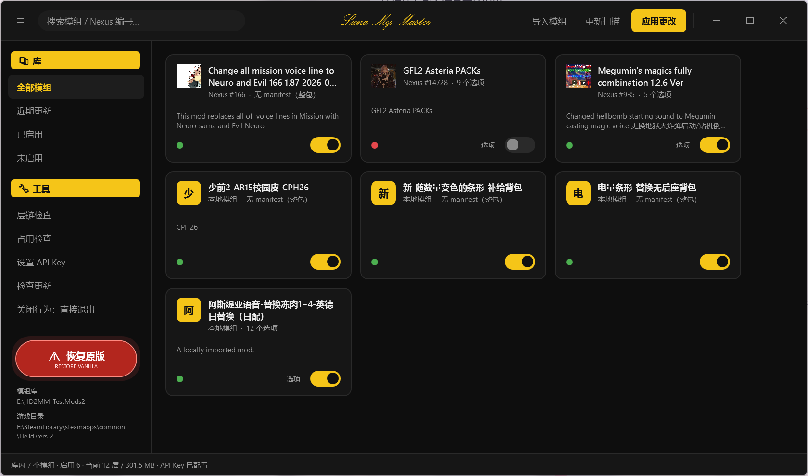

# Luna My Master

《绝地潜兵 2》的模组管理器 —— 把 mod 库、层链诊断、应用/还原做成一个黑黄配色的桌面工具。

## 它能做什么

- **导入**：拖入 zip / rar / 7z，自动解压成 mod 库；同名导入会原地替换（保留启用状态与备注）
- **应用更改**：把启用的 mod 按 bundle 重编号成 `patch_N` 层，用硬链接部署到游戏 `data` 目录（跨盘自动回退到复制）
- **还原原版**：一键清空所有层，游戏回到官方状态
- **层链检查**：列出每个 bundle 的层数 / 来源 mod / 多层覆盖警告
- **占用检查**：按装备代号统计谁占了什么，红绿球 + 护甲/武器标签 + 手动隐藏条目
- **N 网联动**：按 Nexus 编号拉取名称 / 简介 / 图标 / 分类，检测更新（版本号或文件时间戳变化）
- **完整性校验**：记录导入时的文件指纹，文件夹被动过就红字提醒重新导入
- **托盘 / 关闭行为**：可切换"直接退出"或"收进后台"

## 开始使用（在自己的电脑上）

### 1. 拿到程序

**A. 直接下载（推荐）**

- [下载 LunaMyMaster.exe](https://github.com/shizuku147/HELLDIVERS-II-Mods-Manager-2-/releases/download/V1.0.0/LunaMyMaster.exe)（V1.0.0，约 415 KB）
- 下载后放到任意文件夹，双击即用 —— 例如 `D:\Tools\LunaMyMaster\`
- 电脑需要 **Windows 10/11** + **.NET 9 桌面运行时**（[下载](https://dotnet.microsoft.com/download/dotnet/9.0)）

**B. 自己构建**

```powershell
git clone git@github.com:shizuku147/HELLDIVERS-II-Mods-Manager-2-.git
cd HELLDIVERS-II-Mods-Manager-2-
dotnet publish HD2MM.csproj -c Release -r win-x64 --self-contained false `
  -p:PublishSingleFile=true -p:IncludeNativeLibrariesForSelfExtract=true -o out
```

生成的 `out\LunaMyMaster.exe` 就是程序本体，可以挪到任何地方。

> 想让它完全免装运行时，把 `--self-contained false` 换成 `true`，体积会变成约 70 MB。

### 2. 首次启动配置

双击 exe 后，程序会要求设置两个目录：

| 设置项 | 填什么 | 典型值 |
|---|---|---|
| **游戏目录** | 游戏根目录（里面有 `data` 文件夹和 `helldivers2.exe`） | `E:\SteamLibrary\steamapps\common\Helldivers 2` |
| **模组库** | 存放解压后 mod 的文件夹，可以新建 | `E:\HD2Mods` |

然后在左侧「工具 → 设置 API Key」填入 Nexus API Key（可选，不填就没有图标/简介/更新检测）：
到 [nexusmods.com](https://www.nexusmods.com) → 头像 → **Account settings** → **API** → 生成 personal API key。

### 3. 日常流程

```
拖入压缩包  →  打开开关  →  点「应用更改」  →  进游戏
```

- 换一套 mod：关掉旧的、打开新的，再点一次「应用更改」
- 想回官方原版：点左下角红色的「恢复原版」
- **应用更改前请关闭游戏**（程序也会检查，游戏在跑时会拒绝部署）

## 界面预览



## 文件与部署位置

| 内容 | 位置 |
|---|---|
| 程序本体 | 你放 exe 的地方（如 `D:\Tools\LunaMyMaster\LunaMyMaster.exe`） |
| 配置 / 状态 | `%APPDATA%\HD2MM\settings.json` |
| Nexus API Key（DPAPI 加密） | `%APPDATA%\HD2MM\secret.bin` |
| 最近一次部署的层来源 | `%APPDATA%\HD2MM\layers.json` |
| mod 库 | 你设置的模组库目录，每个 mod 一个子文件夹 |
| **部署到游戏的层** | `<游戏目录>\data\<bundleHash>.patch_N`（+ `.stream` / `.gpu_resources`） |

部署是用 `CreateHardLinkW` 建的硬链接：**不占额外磁盘**、应用/还原都很快。跨盘符时自动回退成复制。

还原原版只删除程序自己写的 `patch_*` 文件，不会碰游戏本体资源。

## 一些实现细节

- `.NET 9` + `WPF`，无第三方依赖
- 自绘无边框窗口：`WindowChrome` + DWM 圆角 + 自定义最小化/恢复动画（拦截 `WM_SYSCOMMAND/SC_MINIMIZE`）
- Nexus API key 用 DPAPI 加密存在 `%APPDATA%\HD2MM\secret.bin`
- 层部署前会重编号，并在同 bundle 内按「共享材质 → 变体」排序；`DO NOT DISABLE` 的选项强制部署
- 每个 mod 导入时记录「文件数:总字节数」指纹，文件被动过会提示重新导入

## 说明

- 仅供个人整理模组用，**使用前请自行备份游戏 `data` 目录**
- 与 Arrowhead / Sony 无任何关联
